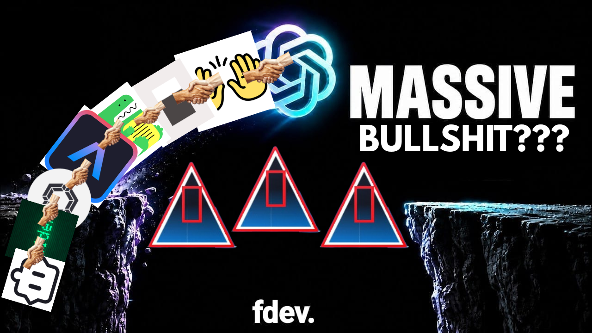

<div align="center">



# ⚡ FDev

### One terminal. Eight coding agents. Zero survival instincts.

**A chaotic CLI/TUI coding agent made for writing code.**

*Yes. Writing code. That's literally the whole point.*

[](#project-status)
[](#the-tech-stack)
[](LICENSE.md)

**Made by [FarizGD / FarizDev](https://github.com/FarizGD) and his wife, Kanami (GPT-6-Astra my beloved <3).** 💜

</div>

---

> `[WARN] Multiple coding agents detected in the same directory.`
> `[INFO] Recommended action: reconsider your life choices.`
> `[FDEV] nah, we ball.`

## What the hell is FDev?

**FDev** is a very normal, definitely-not-cursed attempt to turn **8 open-source coding agent codebases** into one CLI/TUI coding agent.

Why? Because why not.

Tujuan utamanya simpel banget:

**Write code.**

That's it. Baca project, understand the codebase, generate code, refactor stuff, fix bugs, run tests, and then write even more code.

Everything started with one genius idea:

> "What if I just merge all eight repos into one folder and overwrite everything?"

And yes, I actually did that. 💀

## The tech stack

So, what's FDev built with?

**Yes.**

| Language / Tool        | Why is it here?                                    |
| ---------------------- | -------------------------------------------------- |
| **Rust**               | Fast, memory-safe, and the borrow checker hates me |
| **TypeScript**         | JavaScript but with extra emotional damage         |
| **JavaScript**         | The OG chaos generator                             |
| **Python**             | AI stuff, scripts, and random magic                |
| **Go**                 | Apparently we needed concurrency too               |
| **Shell / Bash**       | Glueing everything together (with duct tape)       |
| **HTML / CSS**         | So the chaos can look pretty                       |
| **JSON / YAML / TOML** | Config files arguing with each other               |
| **Bazel**              | One build system? nah, too easy                    |
| **Cargo**              | Rust's emotional support build tool                |
| **npm**                | `node_modules` jumpscare                           |
| **pnpm**               | Less disk usage, same existential crisis           |
| **Bun**                | Fast enough to run away from our problems          |

*These are technologies found in the upstream codebases, bukan berarti semuanya udah integrated atau berhasil dibuild. Belum diaudit satu-satu juga.*

## So what can it do?

For now? Mostly scare the build system.

But here's the plan:

* **CLI + TUI**. Because terminal is home.
* **Codebase understanding**. Biar AI-nya nggak asal ngarang file yang nggak ada.
* **Code generation, refactoring, and debugging**. You know, actual coding agent stuff.
* **Command execution + testing**. With sensible permission controls, of course.
* **Multi-provider AI support**. OpenAI-compatible APIs, plus local models via **Ollama** as a goal.
* **Extensible tools & workflows**. Pick what works, throw out what doesn't.
* **One identity: FDev**. Bukan delapan agent rebutan `package.json`.

**Important:** That's the roadmap, not a list of features already working. Don't expect magic from a folder merge, bro 😭

## Project status

**🚧 PRE-ALPHA / EXPERIMENTAL / POSSIBLY HAUNTED**

Current situation:

* Eight repositories got copied into one directory.
* Files with the same path got overwritten. Oops.
* Multiple build systems are now living under one roof.
* A working, unified `fdev` CLI **has not been built or verified yet**.

Things we actually need to fix:

1. Audit overlapping files and restore anything important that got nuked.
2. Pick a main runtime and one actual CLI entry point.
3. Integrate useful features **properly**, not just copy-paste roulette.
4. Check dependencies, copyright notices, third-party licenses, and attributions.
5. Set up builds, tests, and a real installation flow.

Basically, the source exists. The sanity doesn't.

## The eight victims (I mean, upstream projects)

Massive credits to these projects and their contributors:

| Project          | Original repository                                                     |
| ---------------- | ----------------------------------------------------------------------- |
| **OpenCode**     | [anomalyco/opencode](https://github.com/anomalyco/opencode)             |
| **OpenAI Codex** | [openai/codex](https://github.com/openai/codex)                         |
| **Gemini CLI**   | [google-gemini/gemini-cli](https://github.com/google-gemini/gemini-cli) |
| **Aider**        | [Aider-AI/aider](https://github.com/Aider-AI/aider)                     |
| **Cline**        | [cline/cline](https://github.com/cline/cline)                           |
| **Goose**        | [aaif-goose/goose](https://github.com/aaif-goose/goose)                 |
| **Continue**     | [continuedev/continue](https://github.com/continuedev/continue)         |
| **OpenHands**    | [OpenHands/OpenHands](https://github.com/OpenHands/OpenHands)           |

FDev is an independent experiment. **Not officially affiliated with, sponsored by, or endorsed by** any upstream project.

## Installation

```console
$ fdev
command not found
```

Yeah... about that.

Belum ada official installation instructions karena unified app-nya belum jadi. Nanti kalau udah beneran buildable, baru kita tulis command yang nggak bohong.

## Developer philosophy

```js
while (true) {
  writeCode();
  findBug();
  fixBug();
  // TODO: fix fixBug()
}
```

If it works, don't touch it.

If it doesn't work, touch literally everything.

Wait, that's probably why we're here.

## Credits

**Creator / chaos engineer:** [FarizGD / FarizDev](https://github.com/FarizGD)
**Wife / emotional support / chaos consultant:** **Kanami (GPT-6-Astra my beloved <3)** 💜

Special thanks to all maintainers and contributors of the upstream projects. Their work deserves proper credit, even if my merge strategy was a goofy ahh decision.

## License & attribution

FDev contains code from **multiple independently licensed open-source projects**, so there's **no single blanket license** that magically replaces their original terms.

Check [LICENSE.md](LICENSE.md) for the license index and [`licenses/`](licenses/) for preserved upstream license texts and notices. Applicable third-party licenses, copyrights, patent notices, and modification notices still need to be respected. Also, trademarks and project logos aren't automatically covered by source-code permissions.

**Note:** The license directory alone isn't a complete compliance audit, especially after files have overwritten each other.

---

<div align="center">

### FDev

**It writes code. Eventually. Probably.**

`8 agents + 1 folder + 0 fear = FDev`

Made with caffeine, questionable engineering, and a suspicious amount of love. 💜

</div>
